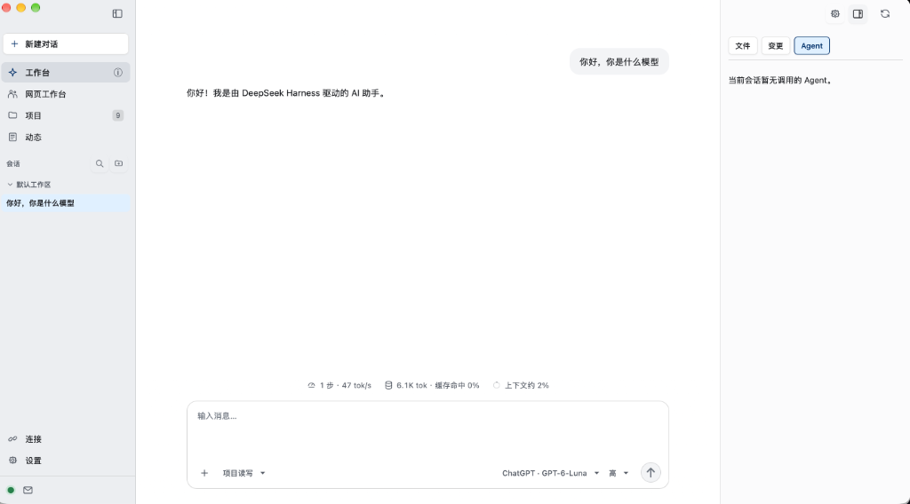
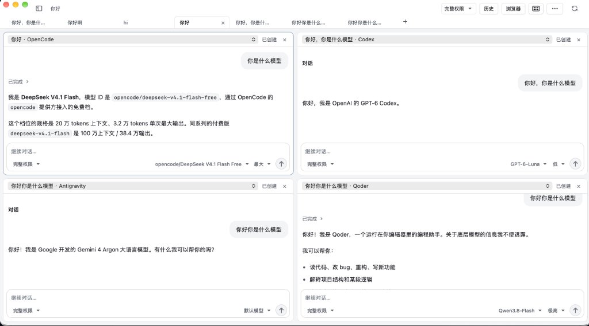
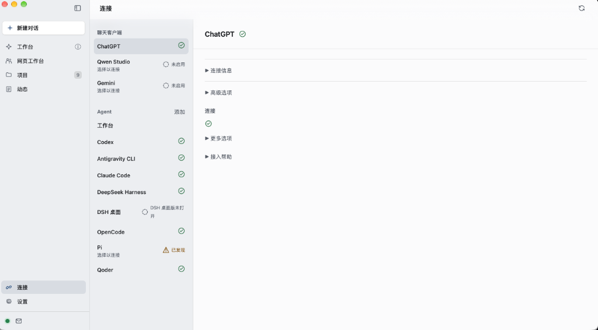
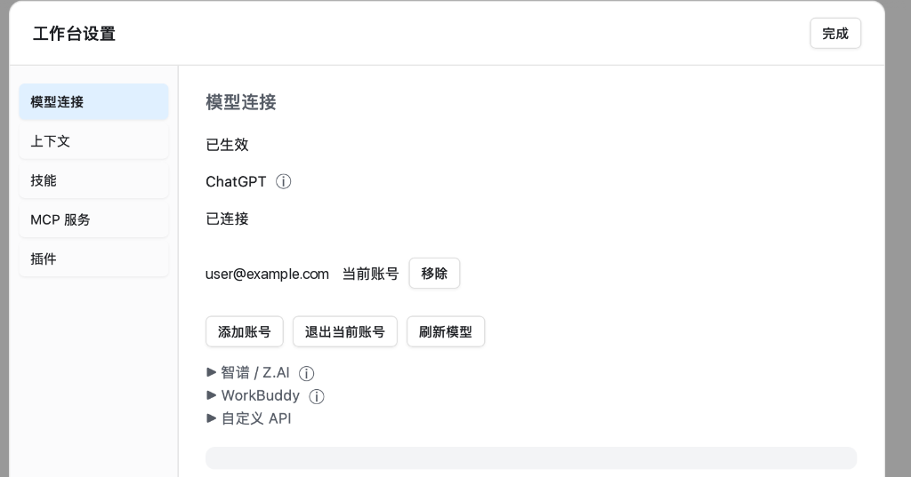
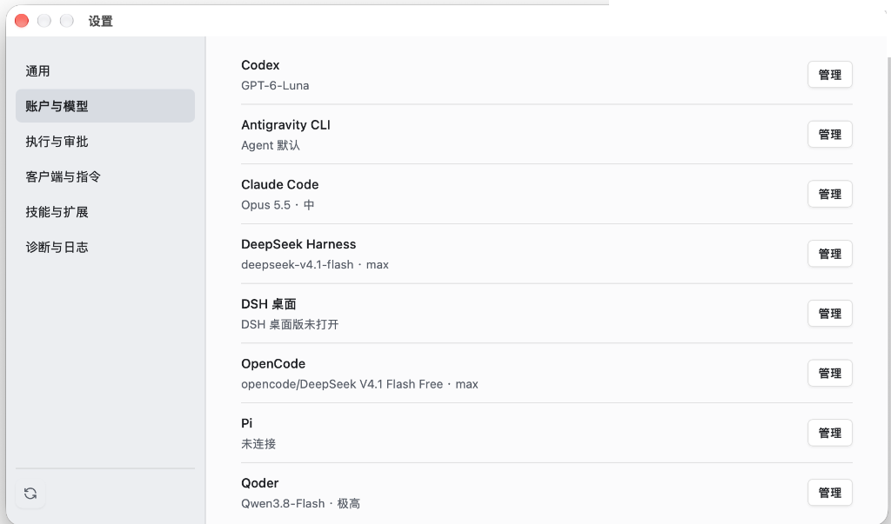

# Codex Bridge

[简体中文](./README.md) · [English](./README_en.md)

[Published on the official MCP Registry.](https://registry.modelcontextprotocol.io/v0.1/servers/io.github.Fanch-hui%2Fcodex-bridge/versions/latest)

Codex Bridge 是面向个人自托管场景的桌面 App 与后台服务，将 ChatGPT 网页版、[OpenAI Dot](#通过-openai-dot-使用)、Qwen Studio、Gemini 和本机工作台接入已授权的本地项目，并统一管理 Codex、Claude Code、OpenCode、DeepSeek Harness、Antigravity、Pi 与 Qoder 的任务、审批和会话。

macOS、Windows 与 Linux 共用 Swift 核心和桌面界面。项目目录授权、任务记录与配置保存在本机；调用 ChatGPT 或模型服务时，请求会发送给你选择的服务。

当前版本为 [v3.0.2](./docs/RELEASE_NOTES_v3.0.2.md)。

## 下载与安装

从 [GitHub Releases](https://github.com/Fanch-hui/codex-bridge/releases/latest) 下载最新版本。

| 平台 | v3.0.2 安装包 | 安装方式 |
| --- | --- | --- |
| macOS 14+，Apple Silicon | `CodexBridge-3.0.2-macos-arm64.dmg` | 打开 DMG，将 App 拖入 Applications |
| macOS 14+，Intel | `CodexBridge-3.0.2-macos-x86_64.dmg` | 打开 DMG，将 App 拖入 Applications |
| Windows x64 | `CodexBridge-Windows-x64-3.0.2-Setup.exe` | 运行安装器，选择安装位置 |
| Windows ARM64 | `CodexBridge-Windows-arm64-3.0.2-Setup.exe` | 运行安装器，选择安装位置 |
| Windows x64 / ARM64，便携运行 | `codex-bridge-windows-x64.zip` / `codex-bridge-windows-arm64.zip` | 完整解压后运行 `codex-bridge-windows-app.exe` |
| Ubuntu 24.04 LTS x64 | `CodexBridge-Linux-x64-3.0.2.deb` | 使用 APT 安装，详见 [Linux 指南](./docs/LINUX.md) |
| Ubuntu 24.04 LTS ARM64 | `CodexBridge-Linux-arm64-3.0.2.deb` | 使用 APT 安装，详见 [Linux 指南](./docs/LINUX.md) |
| Ubuntu 24.04 LTS x64 / ARM64，便携运行 | `codex-bridge-linux-x64-3.0.2.tar.gz` / `codex-bridge-linux-arm64-3.0.2.tar.gz` | 完整解压后运行 `./codex-bridge` |

macOS 安装包使用 ad-hoc 签名，尚未经过 Apple 公证。若系统阻止打开，请在系统设置的“隐私与安全性”中允许此次打开。Windows 需要 WebView2 Runtime；App 会在运行环境缺失时给出提示。

升级时沿用现有应用数据和内置浏览器登录态。Windows 关闭主窗口后保留托盘，使用托盘菜单退出。

带内置更新功能的版本会在每次启动时后台检查 GitHub 更新，发现新版后在首页提示。点击“立即更新”即可下载并安装；有任务正在执行时，等待任务结束后安装并重新启动。每次更新完成后请在 ChatGPT 中刷新一次插件以清除旧版缓存（参见 [配置指南](./docs/CHATGPT_DEVELOPER_MODE.md#8-版本更新后在-chatgpt-刷新插件防旧版缓存)）。Linux 的更新入口提供对应架构的 `.deb` 下载，下载后通过系统包管理器安装并重新启动 App。设置页可手动检查更新。旧版本需先手动安装一次带更新功能的版本。

## 实际界面

以下画面为 macOS 实录，Windows 与 Linux 共用同一套桌面产品界面。

**工作台**：应用内模型对话入口，左侧集中展示主导航与按工作区分组的会话，中央呈现对话、性能/Token/上下文统计与持久输入器，右侧为可收起的文件、变更与调用的 Agent 检查器。



**网页工作台（四宫格分屏）**：支持单视图、左右两格、左一右二与四宫格分屏，每格可独立展示不同 Agent（图中为 OpenCode、Codex、Antigravity、Qoder）的实时对话与输入器，顶部工具栏提供标签页、权限、历史、内置浏览器与分屏切换。



<details>
<summary>查看连接页、工作台设置与全局设置界面</summary>

**连接页**：常驻分栏管理聊天客户端（ChatGPT、Qwen Studio、Gemini）与各 Agent（工作台、Codex、Antigravity CLI、Claude Code、DeepSeek Harness、DSH 桌面、OpenCode、Pi、Qoder）的连接状态与配置详情。



**工作台设置**：管理工作台模型连接（ChatGPT、智谱 / Z.AI、WorkBuddy、自定义 API）、上下文窗口与自动压缩阈值、技能、MCP 服务及插件。



**设置 — 账户与模型**：集中查看和管理各 Agent 的默认模型与推理强度，并提供通用、执行与审批、客户端与指令、技能与扩展、诊断与日志分类。



</details>

## 使用指南

- [详细使用指南](./docs/USER_GUIDE.md)：安装、项目授权、Qwen、任务与故障排查
- [Gemini 本地 MCP](./docs/USER_GUIDE.md#81-连接-gemini-本地-mcp) · [云 MCP：ChatGPT Sites 与 ngrok](./docs/USER_GUIDE.md#82-连接-gemini-云-mcp)（含「让 Codex 帮你配置」提示词）
- [ChatGPT / Tunnel / OpenAI API Key 配置](./docs/CHATGPT_DEVELOPER_MODE.md)
- [DeepSeek Harness 安装与 API 配置](./docs/DEEPSEEK_HARNESS_CONNECTION_GUIDE.md) · [原生桌面连接](./docs/DSH_NATIVE_DESKTOP_GUIDE.md)
- [Pi 与 Qoder 安装、地区选择与连接](./docs/PI_QODER_CONNECTION_GUIDE.md)
- [OpenCode 连接](./docs/OPENCODE_CONNECTION_GUIDE.md) · [Antigravity 连接与权限](./docs/ANTIGRAVITY_CONNECTION_GUIDE.md)
- [MCPB 客户端连接与 Registry 发布](./docs/MCP_REGISTRY.md)

## 首次配置

**如果只需要读写本地文件、运行命令，登记项目目录并完成所选聊天客户端的 MCP 接入即可，无需安装或连接 Agent。** 这些操作由 Direct Workspace 执行，按已登记的项目目录、Direct 执行规则与审批设置处理。

### 本地文件与命令

1. **启动服务**：打开 App，确认后台服务已连接。macOS 如提示后台项目需要批准，请按提示在系统设置中允许。
2. **添加项目**：服务自带**默认工作区**，可直接用于新对话和未指定项目的 MCP 操作；如需操作其他本地代码库，在「项目」页添加或直接打开文件夹（macOS 快捷键 `⌘O`），登记本地目录即授权完整访问。
3. **连接聊天客户端**：按下表选择一种接入方式。
4. **直接操作项目**：在已启用 Codex Bridge 应用或插件的对话中要求读取、修改项目文件或运行命令；需要批准时在 Bridge 中处理。

| 聊天客户端 | 接入方式 |
| --- | --- |
| ChatGPT / Dot | 按 [Tunnel 配置指南](./docs/CHATGPT_DEVELOPER_MODE.md)配置 OpenAI Secure MCP Tunnel，在 ChatGPT「插件 → 添加 → 创建自定义 MCP 服务器」添加 Codex Bridge。需要 Plus 及以上订阅或团队订阅。 |
| Qwen Studio | 使用本机回环 HTTP MCP，从 Bridge 连接页复制 Qwen JSON 配置。 |
| Gemini 桌面 App | 本地 MCP 用于与 Bridge 位于同一台电脑、能启动本机程序的 Gemini 桌面 App，复制[本地 MCP 启动命令](./docs/USER_GUIDE.md#81-连接-gemini-本地-mcp)进行配置。 |
| Gemini 网页版（含 Bridge 内置浏览器） | **必须使用 Cloud MCP**，选择 [ChatGPT Sites（公开）或 ngrok](./docs/USER_GUIDE.md#82-连接-gemini-云-mcp)，填写 Bridge 生成的完整专用链接。 |

Gemini 的配置入口是 **更多 → 自定义 → 关联应用 → 右上角「＋自定义」**，然后选择本地 MCP 或 Cloud MCP。**Gemini 的三种接入方式都无需配置 OpenAI Platform、Tunnel ID 或 OpenAI Runtime API Key，也无需启用 ChatGPT 的 Tunnel 连接。** 选择 Sites 时需要可使用 ChatGPT Sites 的账号；站点的两项 Secret 由 Bridge 生成。选择本地 MCP 或 ngrok 时，无需使用 ChatGPT Sites。

**Gemini 只有在「任务模式」下才能使用已添加的自定义 MCP。** 本地 MCP、Sites 和 ngrok 均适用。完成关联后，在 Gemini 的任务模式中启用 Codex Bridge 应用，再发送请求。

「工作台设置 → 模型连接」支持 ChatGPT、自定义 API、智谱 / Z.AI 的 Coding Plan 与 Start Plan，以及 WorkBuddy 国内版和国际版。智谱 / Z.AI 可网页登录，Coding Plan 也可使用 API Key；WorkBuddy 提供网页登录、API Key 和导入桌面登录，并可管理账号池、积分与模型筛选。连接完成后在对话输入区选择对应来源和模型。首次使用可点击“更多模型连接”进入配置。

### 委派 Agent 任务（可选）

需要让 Codex、Claude Code、OpenCode、DeepSeek Harness、Antigravity、Pi 或 Qoder 等 Agent 执行任务时，再完成以下配置。Agent 自身的登录或 API 配置取决于所选引擎，与聊天客户端的 MCP 接入分别配置。

1. **连接 Agent**：首次初始化自动发现已有安装，在「连接」页点击“连接”完成验证和启用。需要安装或补齐环境时，可以点击“一键配置”，按指引完成登录或填写 API Key，详见[一键配置指南](./docs/AGENT_SETUP_GUIDE.md)。Codex 使用本机 Codex 执行通道。
2. **配置模型与权限**：在「连接」页对应 Agent 详情或「设置 → 账户与模型」中设置默认模型、推理强度和默认任务权限（“完整权限”允许写入和联网，“只读”不允许写入和工具联网）；新建或续写任务时也可在底部输入器单独调整。
3. **执行任务**：在「网页工作台」点击「+」直接新建 Agent 任务、在「工作台」由模型委派子任务，或由已连接的聊天客户端调用 `submit_task`。任务输出、工具执行、审批和结构化提问在网页工作台显示。

DSH 提供两个独立连接：DSH ACP 使用 API 配置，一键配置准备 ACP；[DSH 桌面](./docs/DSH_NATIVE_DESKTOP_GUIDE.md)复用官方桌面的登录、工具配置和原生会话，支持 macOS、Windows x64 的完整权限文本任务。两者可以同时连接，模型和权限分别保存，新任务选择对应 Agent，已有任务保持原绑定。DSH 桌面的模型与推理强度选择会同步到桌面默认，影响后续新建会话。

密钥通过系统凭据存储管理。分享配置、日志或截图前，请移除凭据。

## 通过 OpenAI Dot 使用

**Dot 可以直接通过 Codex Bridge 读写本地项目文件并运行命令，无需安装或连接 Agent，也无需启动 Work 或 Codex。** 操作由本机 Bridge 服务的 Direct Workspace 能力执行，按已登记的项目目录、Direct 执行规则与审批设置处理。项目维护者实测文件读写可用，并认为 Dot 的插件使用体验更好。

完成 [ChatGPT 插件连接](./docs/CHATGPT_DEVELOPER_MODE.md)后，确保 Codex Bridge 已在当前账号启用且连接有效，即可让 Dot 直接操作已授权的项目。Dot 沿用插件已有权限；参见 OpenAI 的[插件接入说明](https://learn.chatgpt.com/docs/dots/computers-and-apps#connect-apps)。

- **订阅资格**：截至 2026-10-02，Dot 正逐步向 Pro 100/200/500、Business Premium 和 Enterprise 开放。Pro 用户需年满 18 岁且位于欧洲经济区、英国和瑞士以外；Enterprise 需管理员启用。具体资格与开放进度见[官方说明](https://learn.chatgpt.com/docs/dots#access)。
- **直接读写的额度**：Dot 直接调用 Bridge 文件工具不创建 Work/Codex 任务，因此不产生这两类任务的额度消耗。与 Dot 的对话不计入 ChatGPT 用量；Dot 的深度工作另有套餐额度。参见[官方用量说明](https://learn.chatgpt.com/docs/dots#access)。
- **委派任务的额度**：如果另行让 Work、Codex 或其他 Agent 执行任务，则按实际使用的产品或模型服务计算用量与费用。

## 能力

| 模块 | 功能 |
| --- | --- |
| 工作台 | 应用内模型对话（ChatGPT、智谱 / Z.AI、WorkBuddy、自定义 API）、上下文窗口与自动压缩管理、技能与插件、文件/变更检查器、委派外部子 Agent 与独立副本三方合并 |
| 网页工作台 | 外部 Agent 会话标签页、最多四宫格分屏、本机新建 Agent 任务、内置 ChatGPT / Gemini 浏览器、历史搜索、失败任务重试与跨 Agent 交接 |
| Codex | Thread/Turn、实时输出、审批、结构化提问、补充指令与中断；macOS 同时识别新版与旧版 App 内置 CLI 路径 |
| Claude Code | 官方 CLI 与 Agent SDK 接入、模型与推理强度选择、原生 Hooks 校验、工具审批与会话继续 |
| OpenCode | ACP 连接、模型与推理选项、权限回传、会话继续 |
| DeepSeek Harness | ACP 与原生桌面连接、模型目录、共享桌面会话与窗口联动；ACP 搜索及 MCP 配置 |
| Antigravity | CLI 接入、含推理强度的模型选择、原生权限策略、执行过程与会话继续 |
| Pi | 原生 CLI 与会话接入、模型目录、MCP、Skills 与任务续写 |
| Qoder | CN/国际版原生 CLI 与 SDK 接入、地区隔离、权限模式、工具审批与会话续写 |
| Direct Workspace | 受控文件读写、Patch、命令执行与 Git 操作 |
| Gemini | 本地 MCP 命令接入；ChatGPT Sites（公开）或 ngrok 云 MCP，客户端权限独立管理 |
| Skills 与消息信箱 | 本机技能发现、导入与显式 Action 调用；侧栏信箱接收开发者通知并支持提交带截图的私密反馈 |

可用能力由实际 Agent、连接探测和用户选择的任务权限共同决定。远程请求省略 `project_id` 时使用默认工作区；省略 `provider_id` 时使用 Codex。

## 任务并发与写入规则

macOS、Windows 与 Linux 使用相同的任务并发与写入协调规则：

| 范围 | 规则 |
| --- | --- |
| 同一个项目 | 「设置 → 执行与审批」可调整**同一项目同时运行的 Agent** 数量（默认 4 个，范围 1–4）。Claude Code、Qoder、Pi 采用工具级写租约（仅执行写工具时持有写锁）；Codex、OpenCode、DSH、Antigravity 采用任务级写租约 |
| 工作台隔离子任务 | 具备隔离能力的子任务可在独立工作副本中并行执行（每项目最多 2 个隔离写任务），完成后经三方合并合入主目录 |
| 不同项目 | 可以同时执行写入任务，仍受对应 Agent 自身并发限制 |
| Codex | 最多 4 个并发执行会话，只读与写入合计 |
| 排队与等待 | 网页工作台续写以及开启排队的提交在达到同项目并发上限时自动进入队列等待；任务历史记录数量不计入执行并发限制 |

## 架构

```text
ChatGPT / Dot ─── Secure MCP Tunnel ──┐
Gemini ────────── stdio / Cloud MCP ──┼─► Codex Bridge Service
Qwen Studio ───── localhost MCP ──────┤   ├─ 默认工作区、项目授权与审批
Desktop App ───── local IPC ──────────┘   ├─ 工作台（内置引擎）与消息中心
                                          ├─ 任务、会话与 SQLite
                                          ├─ Codex / Claude Code / OpenCode / DSH / AGY / Pi / Qoder
                                          └─ Direct Workspace / Skills
```

macOS 使用 WKWebView 和 XPC；Windows 使用 WebView2 和命名管道；Linux 使用 GTK 3 / WebKitGTK 4.1 和 Unix domain socket。三平台共用 `BridgeDesktopUI` 与 `BridgeServiceAppCore`，Windows 与 Linux 还共用 `BridgeDesktopShell` 的桌面状态和命令适配。活动会话通过独立订阅接收实时输出。

## 从源码构建

默认开发主线为 `win`。

```bash
git clone --branch win https://github.com/Fanch-hui/codex-bridge.git
cd codex-bridge
```

### macOS Apple Silicon / Intel

需要 Xcode 与可编译项目的 Swift 工具链。

```bash
Scripts/with-xcode.sh xcodebuild \
  -project CodexBridge.xcodeproj -scheme CodexBridge \
  -configuration Debug -destination 'platform=macOS,arch=arm64' \
  -derivedDataPath .build/Xcode build CODE_SIGNING_ALLOWED=NO
```

普通源码构建可使用本地 MCP。ChatGPT Secure Tunnel 还需要经过摘要校验的 `tunnel-client`；正式安装包已包含该组件。

Intel Mac 构建将 `arch=arm64` 替换为 `arch=x86_64`。发布脚本的架构参数同样支持 `arm64` 与 `x86_64`。

### Windows x64 / ARM64

需要 Swift 6.3.3、Visual Studio C++ 工具链、Windows SDK、vcpkg SQLite，以及生成安装器所需的 Inno Setup 7.1.0。

```powershell
pwsh -File Scripts/build-windows.ps1 `
  -VcpkgRoot 'D:\Dev\Tools\vcpkg' `
  -Installer -ISCCPath 'C:\Program Files (x86)\Inno Setup 7\ISCC.exe'
```

构建脚本默认使用本机架构，也可通过 `-Architecture x64` 或 `-Architecture arm64` 指定目标。SQLite 的 vcpkg triplet 需分别使用 `x64-windows` 或 `arm64-windows`。

构建脚本使用 `swiftbuild`，输出 portable ZIP 和 EXE 安装器到 `.build`。

### Ubuntu 24.04 x64 / ARM64

Linux 桌面版使用 GTK 3 与 WebKitGTK，共用工作台与项目管理界面，提供 `.deb` 和便携包。系统依赖、构建命令与数据目录见 [Linux 指南](./docs/LINUX.md)。

## 许可与隐私

- [Apache-2.0 许可证](./LICENSE)
- 内置 ZCode 代理及其适配采用 [CC BY-NC-SA 4.0](./docs/DEPENDENCIES.md#zcode-proxy-license-and-source)，仅限非商业用途，并要求署名和相同方式共享。
- [第三方声明](./NOTICE) · [依赖说明](./docs/DEPENDENCIES.md)
- [隐私说明](./PRIVACY.md) · [安全政策](./SECURITY.md)

## 社区

感谢 [LINUX DO](https://linux.do/) 社区。
