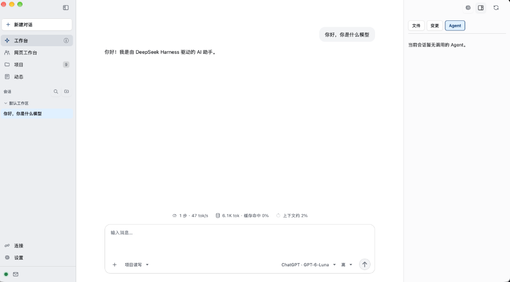
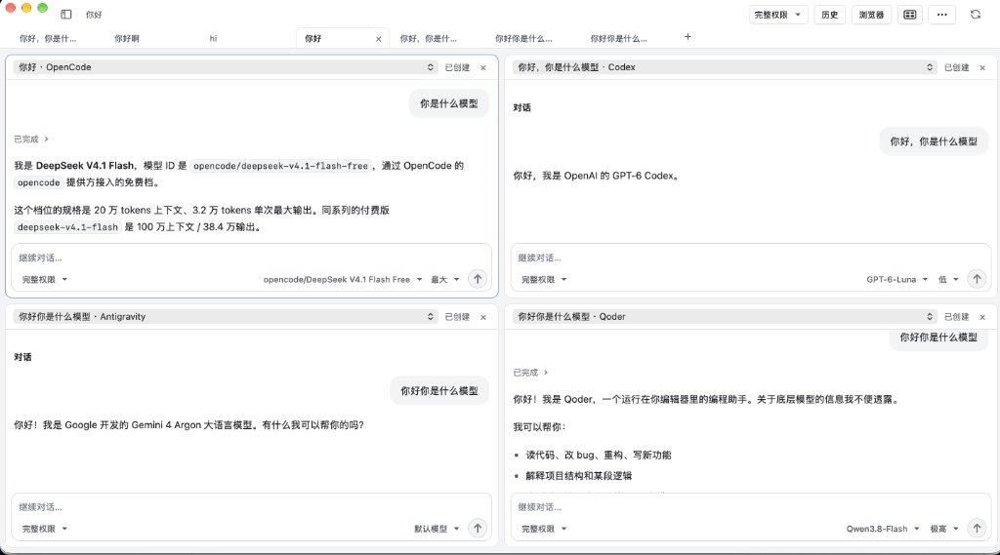
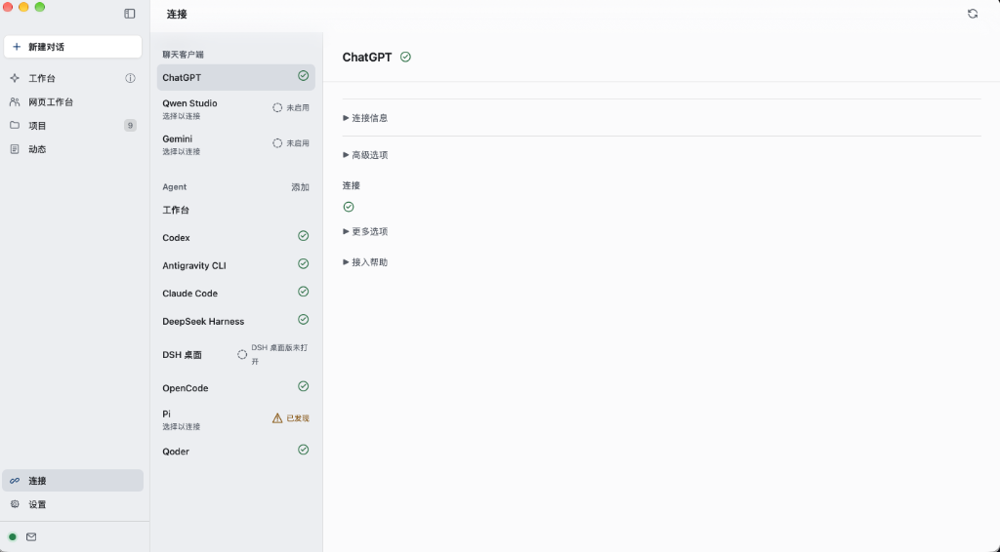
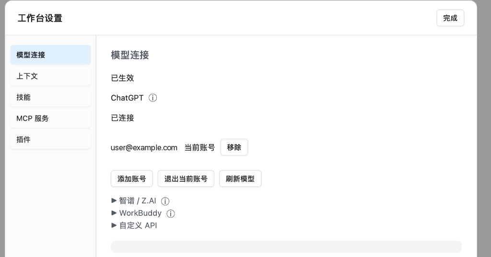
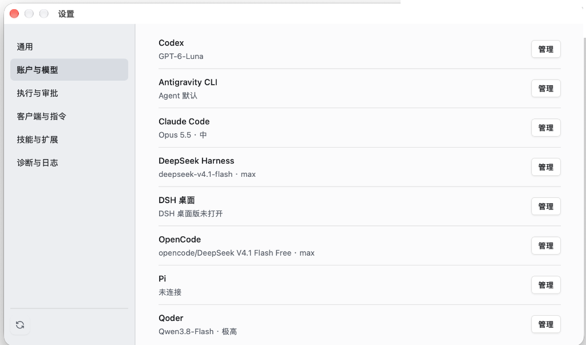

# Codex Bridge

[简体中文](./README.md) · [English](./README_en.md)

[Published on the official MCP Registry.](https://registry.modelcontextprotocol.io/v0.1/servers/io.github.Fanch-hui%2Fcodex-bridge/versions/latest)

Codex Bridge is a self-hosted desktop app and background service that connects ChatGPT on the web, [OpenAI Dot](#use-with-openai-dot), Qwen Studio, Gemini, and a local workbench to explicitly authorized projects. It manages tasks, approvals, and conversations across Codex, Claude Code, OpenCode, DeepSeek Harness, Antigravity, Pi, and Qoder.

macOS, Windows, and Linux share the Swift core and desktop UI. Project directory authorizations, configuration, and task history are stored locally. Requests are sent to the services you choose when using ChatGPT or a model API.

The current release is [v3.0.2](./docs/RELEASE_NOTES_v3.0.2.md).

## Download and install

Get the latest version from [GitHub Releases](https://github.com/Fanch-hui/codex-bridge/releases/latest).

| Platform | v3.0.2 package | Installation |
| --- | --- | --- |
| macOS 14+, Apple Silicon | `CodexBridge-3.0.2-macos-arm64.dmg` | Open the DMG and drag the app to Applications |
| macOS 14+, Intel | `CodexBridge-3.0.2-macos-x86_64.dmg` | Open the DMG and drag the app to Applications |
| Windows x64 | `CodexBridge-Windows-x64-3.0.2-Setup.exe` | Run the installer and choose an installation folder |
| Windows ARM64 | `CodexBridge-Windows-arm64-3.0.2-Setup.exe` | Run the installer and choose an installation folder |
| Windows x64 / ARM64, portable | `codex-bridge-windows-x64.zip` / `codex-bridge-windows-arm64.zip` | Extract the complete archive and run `codex-bridge-windows-app.exe` |
| Ubuntu 24.04 LTS x64 | `CodexBridge-Linux-x64-3.0.2.deb` | Install with APT; see the [Linux guide](./docs/LINUX.md) |
| Ubuntu 24.04 LTS ARM64 | `CodexBridge-Linux-arm64-3.0.2.deb` | Install with APT; see the [Linux guide](./docs/LINUX.md) |
| Ubuntu 24.04 LTS x64 / ARM64, portable | `codex-bridge-linux-x64-3.0.2.tar.gz` / `codex-bridge-linux-arm64-3.0.2.tar.gz` | Extract the complete archive and run `./codex-bridge` |

The macOS package is ad-hoc signed and is not Apple-notarized. If macOS blocks the app, allow it in System Settings → Privacy & Security. Windows requires WebView2 Runtime; the app reports a missing runtime.

Upgrades preserve application data and the embedded browser profile. Closing the Windows main window keeps the tray icon; use the tray menu to exit.

Versions with the built-in updater check GitHub once at startup and show available updates on the overview page. Choose Update to download and install; installation waits for active work to finish, then restarts the app. After every update, refresh the plugin in ChatGPT to prevent stale caches (see [ChatGPT Guide](./docs/CHATGPT_DEVELOPER_MODE.md#8-版本更新后在-chatgpt-刷新插件防旧版缓存)). On Linux, the update action opens the matching `.deb` download; install it with the system package manager and restart the app. Settings also provides a manual check. Older versions need one manual installation of an updater-enabled release.

## Product screens

Captured on macOS; Windows and Linux use the same shared desktop UI.

**Workbench**: Built-in model conversation workspace with main navigation and workspace-grouped sessions on the left, live conversation, performance/token/context metrics, and composer in the center, and a collapsible Files / Changes / Agents inspector on the right.



**Web Workbench (4-pane split view)**: View up to four agent sessions side by side (OpenCode, Codex, Antigravity, and Qoder shown here), each with its own live conversation and composer, plus top tabs, permissions, history, built-in browser, and split-view controls.



<details>
<summary>View Connections, Workbench Settings, and Global Settings</summary>

**Connections**: Persistent split view for chat clients (ChatGPT, Qwen Studio, Gemini) and agents (Workbench, Codex, Antigravity CLI, Claude Code, DeepSeek Harness, DSH Desktop, OpenCode, Pi, Qoder).



**Workbench Settings**: Configure model connections (ChatGPT, BigModel / Z.AI, WorkBuddy, custom APIs), context window and auto-compaction thresholds, skills, MCP servers, and plugins.



**Settings — Accounts & Models**: Manage default models and reasoning levels across all agents, alongside General, Execution & Approvals, Clients & Instructions, Skills & Extensions, and Diagnostics & Logs.



</details>

## User guides

- [Complete user guide (Chinese)](./docs/USER_GUIDE.md)
- [Gemini local MCP](./docs/USER_GUIDE.md#81-连接-gemini-本地-mcp) · [Cloud MCP through public ChatGPT Sites or ngrok](./docs/USER_GUIDE.md#82-连接-gemini-云-mcp) (Chinese; includes a copyable Sites setup prompt for Codex)
- [ChatGPT / Tunnel / OpenAI Runtime API Key (Chinese)](./docs/CHATGPT_DEVELOPER_MODE.md)
- [DeepSeek Harness ACP installation and API configuration](./docs/DEEPSEEK_HARNESS_CONNECTION_GUIDE_en.md) · [Native desktop connection (Chinese)](./docs/DSH_NATIVE_DESKTOP_GUIDE.md)
- [Pi and Qoder installation, regions, and connections](./docs/PI_QODER_CONNECTION_GUIDE_en.md)
- [OpenCode (Chinese)](./docs/OPENCODE_CONNECTION_GUIDE.md) · [Antigravity (Chinese)](./docs/ANTIGRAVITY_CONNECTION_GUIDE.md)
- [MCPB client connection and Registry publishing (Chinese)](./docs/MCP_REGISTRY.md)

## First setup

**For local file access and command execution, register a project directory and connect your chosen chat client through MCP. No agent installation or connection is required.** Direct Workspace performs these operations under the registered project directory, Direct execution rules, and approval settings.

### Local files and commands

1. Open the app and confirm that the background service is connected. Approve the macOS background item if prompted.
2. Bridge automatically maintains a **Default Workspace** for new conversations and MCP requests that omit `project_id`. To work with a local repository, register its folder on the **Projects** page or open it directly (`⌘O` on macOS) to authorize full access to that directory.
3. Connect a chat client using one of the options below.
4. In a conversation with the Codex Bridge app or plugin enabled, ask it to read or edit project files or run commands. Handle any required approvals in Bridge.

| Chat client | Connection |
| --- | --- |
| ChatGPT / Dot | Configure OpenAI Secure MCP Tunnel using the [Tunnel guide](./docs/CHATGPT_DEVELOPER_MODE.md), then add the Codex Bridge plugin. Requires Plus or higher, or a Team subscription. |
| Qwen Studio | Use loopback HTTP MCP; copy the Qwen JSON configuration from Connections in Bridge. |
| Gemini desktop app | Local MCP is for a Gemini desktop app running on the same computer as Bridge that can launch local programs. Copy the [local MCP command](./docs/USER_GUIDE.md#81-连接-gemini-本地-mcp) to configure it. |
| Gemini web, including Bridge's built-in browser | **Cloud MCP is required.** Use [public ChatGPT Sites hosting or ngrok](./docs/USER_GUIDE.md#82-连接-gemini-云-mcp) and enter the complete dedicated link generated by Bridge. |

In Gemini, open **More → Customize → Connected apps → + Custom**, then choose local MCP or Cloud MCP. **None of the three Gemini connection options requires OpenAI Platform setup, a Tunnel ID, an OpenAI Runtime API Key, or enabling the ChatGPT Tunnel connection.** Sites hosting requires an account with access to ChatGPT Sites; its two runtime Secrets are generated by Bridge. Local MCP and ngrok do not require ChatGPT Sites.

**Gemini can only use added custom MCP apps in Task mode (任务模式).** This applies to local MCP, Sites, and ngrok. After linking, switch Gemini to Task mode, enable the Codex Bridge app, and send your request.

**Workbench Settings → Model connections** supports ChatGPT, custom APIs, BigModel / Z.AI Coding Plan and Start Plan, and WorkBuddy CN and international accounts. Use browser sign-in for BigModel / Z.AI, or an API key for Coding Plan. WorkBuddy supports browser sign-in, API keys, desktop account import, account pool management, credits, and model filters. Select the connected provider and model in the conversation composer. The first-use screen provides a **More model connections** entry.

### Delegate agent tasks (optional)

To delegate work to Codex, Claude Code, OpenCode, DeepSeek Harness, Antigravity, Pi, or Qoder, complete these additional steps. The selected agent's own sign-in or API configuration is separate from the chat client MCP connection.

1. Bridge discovers existing agents on first initialization; click **Connect** on the Connections page to verify and enable them. The additional **One-click setup** action prepares missing software and dependencies, then guides you through native sign-in or API configuration. See the [setup guide (Chinese)](./docs/AGENT_SETUP_GUIDE.md). Codex uses the local Codex execution channel.
2. Configure the default model, reasoning effort, and task permission (**Read Only** or **Full**) in **Connections** or **Settings → Accounts & Models**, or adjust them per task in the composer. Full includes writes and network tools; Read Only allows neither.
3. Submit a task locally with **+** in the **Web Workbench**, delegate a subagent task from the **Workbench**, or call `submit_task` from a connected chat client. Follow output, tools, approvals, and structured questions in the Web Workbench.

Existing DSH connections and one-click setup use ACP by default. To share official desktop sessions, explicitly select [native desktop mode (Chinese)](./docs/DSH_NATIVE_DESKTOP_GUIDE.md). It reuses Desktop sign-in and tools and supports Full text tasks on macOS and Windows x64. Model and reasoning selections in this mode also update the DSH Desktop default for future sessions.

Credentials are managed through the operating system credential store. Remove credentials before sharing configuration, logs, or screenshots.

## Use with OpenAI Dot

**Dot can read and edit local project files and run commands directly through Codex Bridge, without installing or connecting an agent or starting Work or Codex.** The local Bridge service performs these operations through Direct Workspace, using the registered project directory, Direct execution rules, and approval settings. The project maintainer has tested file access through this workflow and reports a better plugin experience with Dot.

After [connecting the ChatGPT plugin](./docs/CHATGPT_DEVELOPER_MODE.md), enable Codex Bridge for your account and keep its connection active, then ask Dot to work directly with an authorized project. Existing plugin permissions apply; see OpenAI's [plugin connection guide](https://learn.chatgpt.com/docs/dots/computers-and-apps#connect-apps).

- **Access:** As of October 2, 2026, Dot is rolling out to Pro 100/200/500, Business Premium, and Enterprise. Pro access requires age 18+ outside the EEA, UK, and Switzerland; Enterprise requires admin enablement. See [availability](https://learn.chatgpt.com/docs/dots#access).
- **Direct file operations:** Calling Bridge's file tools directly creates no Work or Codex task, so it does not consume either task allowance. Dot conversations do not use your ChatGPT allowance; deeper work has a separate plan allowance. See [official usage details](https://learn.chatgpt.com/docs/dots#access).
- **Delegated tasks:** If you separately ask Work, Codex, or another agent to execute a task, the product or model service used applies its own usage and billing rules.

## Capabilities

- **Workbench:** built-in model conversations (ChatGPT, BigModel / Z.AI, WorkBuddy, custom APIs), context window and auto-compaction management, skills and plugins, files/changes inspector, and external subagent delegation with isolated workspace three-way merge.
- **Web Workbench:** external agent session tabs, up to 4-pane split view, local new agent tasks, built-in ChatGPT / Gemini browser, history search, failed-task retries, and cross-agent handoff.
- **Codex:** Thread/Turn, streaming output, approvals, structured questions, steer, and interrupt; macOS recognizes both current and legacy bundled CLI layouts.
- **Claude Code:** official CLI and Agent SDK integration, model and reasoning selection, native hooks enforcement, tool approvals, and session continuation.
- **OpenCode:** ACP, model and reasoning options, permissions, and conversation continuation.
- **DeepSeek Harness:** ACP and native desktop connections, live model catalogs, shared desktop sessions, and opening the corresponding desktop session; ACP search and MCP configuration.
- **Antigravity:** CLI integration, model IDs that include reasoning levels, native permission policies, execution progress, and conversation continuation.
- **Pi:** native CLI and sessions, model catalog, MCP, Skills, and task continuation.
- **Qoder:** native CN/international CLI and SDK integration, region isolation, permission modes, tool approvals, and session continuation.
- **Direct Workspace:** controlled file access, patches, command execution, and Git operations.
- **Skills & Message Center:** local skill discovery, import, and explicit actions; sidebar inbox for developer notices and private feedback with screenshots.

Effective capabilities depend on the agent, its connection probe, the registered project directory, and user-selected task permissions. Requests without `project_id` use the Default Workspace; requests without `provider_id` use Codex.

## Task concurrency and write coordination

macOS, Windows, and Linux use the same task concurrency and write rules:

| Scope | Rule |
| --- | --- |
| Same project | **Settings → Execution & Approvals** configures concurrent agents per project (default 4, range 1–4). Claude Code, Qoder, and Pi use tool-scoped write leases; Codex, OpenCode, DSH, and Antigravity use task-scoped write leases |
| Isolated subagents | Workbench subagent tasks that support workspace isolation run in parallel working copies (up to 2 isolated write tasks per project) and merge back with three-way conflict handling |
| Different projects | Write tasks can run concurrently, subject to the selected agent's limits |
| Codex | Up to four concurrent execution sessions, counting read-only and write sessions together |
| Queuing | Web Workbench continuations and queued submissions wait in line automatically when a project reaches its concurrency limit; stored task history does not count toward execution limits |

## Architecture

```text
ChatGPT / Dot ─── Secure MCP Tunnel ──┐
Gemini ────────── stdio / Cloud MCP ──┼─► Codex Bridge Service
Qwen Studio ───── localhost MCP ──────┤   ├─ Default workspace, project policy, approvals
Desktop App ───── local IPC ──────────┘   ├─ Workbench (embedded engine) & Message Center
                                          ├─ Tasks, conversations, SQLite
                                          ├─ Codex / Claude Code / OpenCode / DSH / AGY / Pi / Qoder
                                          └─ Direct Workspace / Skills
```

macOS uses WKWebView and XPC; Windows uses WebView2 and named pipes; Linux uses GTK 3 / WebKitGTK 4.1 and Unix domain sockets. All three use `BridgeDesktopUI` and `BridgeServiceAppCore`; Windows and Linux also share desktop state and command adapters in `BridgeDesktopShell`. Active conversations retain independent streaming subscriptions.

## Build from source

The default development branch is `win`.

```bash
git clone --branch win https://github.com/Fanch-hui/codex-bridge.git
cd codex-bridge
```

### macOS Apple Silicon / Intel

Install Xcode and a compatible Swift toolchain.

```bash
Scripts/with-xcode.sh xcodebuild \
  -project CodexBridge.xcodeproj -scheme CodexBridge \
  -configuration Debug -destination 'platform=macOS,arch=arm64' \
  -derivedDataPath .build/Xcode build CODE_SIGNING_ALLOWED=NO
```

A standard source build supports local MCP. ChatGPT Secure Tunnel also requires a verified `tunnel-client`; release packages include it.

For Intel Macs, replace `arch=arm64` with `arch=x86_64`. The release script also accepts either architecture.

### Windows x64 / ARM64

Install Swift 6.3.3, Visual Studio C++ tools, Windows SDK, SQLite through vcpkg, and Inno Setup 7.1.0 for installer generation.

```powershell
pwsh -File Scripts/build-windows.ps1 `
  -VcpkgRoot 'D:\Dev\Tools\vcpkg' `
  -Installer -ISCCPath 'C:\Program Files (x86)\Inno Setup 7\ISCC.exe'
```

The script uses `swiftbuild` and writes the portable ZIP and EXE installer under `.build`.

The build script defaults to the host architecture. Use `-Architecture x64` or `-Architecture arm64` to select a target, with the matching `x64-windows` or `arm64-windows` vcpkg SQLite triplet.

### Ubuntu 24.04 x64 / ARM64

The Linux desktop uses GTK 3 and WebKitGTK with the shared workbench and project interface. Builds produce `.deb` and portable archives. See the [Linux guide](./docs/LINUX.md) for dependencies, build commands, and data locations.

## License and privacy

[Apache-2.0](./LICENSE) · [Third-party notices](./NOTICE) · [Dependencies](./docs/DEPENDENCIES.md) · [Privacy](./PRIVACY.md) · [Security](./SECURITY.md)

The embedded ZCode proxy and its adaptations use [CC BY-NC-SA 4.0](./docs/DEPENDENCIES.md#zcode-proxy-license-and-source), requiring attribution, noncommercial use and share-alike.

## Community

Thanks to the [LINUX DO](https://linux.do/) community.
